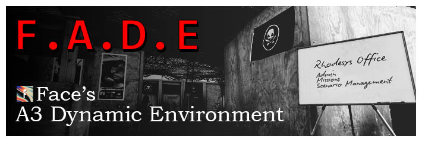
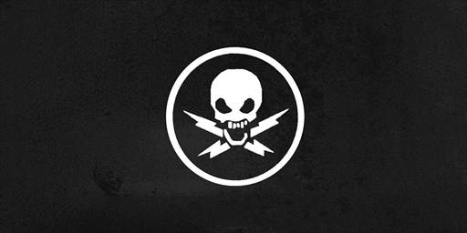

# FADE (Face's Dynamic Environment)
You are welcome to fork this repository and submit pull requests. If you are interested in joining CTB or supporting development of this project, see the discord link below.

🔗 [My YouTube channel](https://www.youtube.com/@iamface) | 🔗 [CTB Discord](https://discord.gg/d5g2dFH)

---

### What is CTB?

Combat Team Bravo (CTB) is an Australian Arma group with over 17 years of history running immersive, story-driven MilSim missions. We run missions every Sunday and Monday night (1930 AEST). We take a approachable milsim approach focused on tactics, techniques and immersion, but not at the expense of fun. There are no ranks, no fixed roles, and no major attendance requirements. Just good missions, solid teamwork, and plenty of banter.

What we offer:
- Narrative-driven MilSim in Arma 3.
- No ranks, no mandatory roles
- 18+ only
- No minimum attendance. Real life comes first, just mark your RSVP!
- Arma 3 training/mini-ops every Sunday
- Arma 3 ops every Monday
- We regularly use Apex, Contact, SOG, GM, and SPE 1944 DLCs for A3
- A welcoming, active community built on mateship and shared interest beyond mission nights

Think you’ve got what it takes to run with one of Australia’s longest-standing Arma units? Join our Discord and start your path with CTB.

---

**FADE (Face's Dynamic Environment) - Beta 8**

This repository holds two missions. `CTB_FAC_FADE.Altis` is the Altis mission. `CTB_FAC_FADE_Portable.Stratis` is the Stratis mission. Both ship on `main` and on `beta`. `main` is the central branch. `beta` is the development branch. The feature list below describes the Altis mission.

FADE is a multiplayer Arma 3 sandbox mission on Altis, tailored for CTB use. Players configure the fight and run training or dynamic missions from boards and GUIs at a fixed player base. You do not need Zeus for day-to-day play.
It is built for rotary, joint fires, and infantry practice on a local or dedicated server and supports up to 31 players currently.
The server owns the scenario state, AI, and mission spawns. Clients use GUIs and get updates over `remoteExec` / public variables. Lobby parameters in `description.ext` set access locks and starting defaults before the mission starts.

### Note on mods

This project utilises several mods which are contained within the mission.sqm. Much of the scenario does not depend on these mods as available equipment for players is governed by reading your running Arma 3 config files.
Some content is hard-coded, such as loadouts and the base layout, and will not function correctly without the CTB modlist loaded. The modlist can be obtained by joining the CTB discord.

### How a session runs
As of Beta 8, you can access GUIs from either their in-world location (the terminals or boards) or via ACE Self-Interact.
1. Open **Manage Scenario** at the mission board or via ACE self-interact: weather, time, friendly/enemy/civilian factions, OPFOR threat, civilians, gear policy, and related options.
2. Open **Manage Missions**: pick a type, read the in-GUI blurb, start. Some types ask for a map click or player pick first.
3. Use ACE self-interact base terminals and boards for vehicles, loadouts, recruit AI, fast travel, CQB, jukebox, medical training, live-fire / AT / sniper ranges, and the FIRES range.

Admins and Zeus can usually override group-leader-only GUI locks. Changes from Scenario apply on the server and sync to players who join later (JIP).

## Features

### Scenario control

- Weather, time of day, and gear policy (including optional ACE Arsenal on loadout boxes).
- Friendly, enemy, and civilian factions from `CfgFactionClasses`, limited to factions the server can spawn infantry for. Friendly list covers EAST / WEST / GUER. Enemy list is filtered to opposed sides (GUER counts as hostile to both majors). Apply rejects a faction with no infantry and keeps the previous one. Invalid mixes are corrected on Apply with a hint; player side syncs on Apply, JIP, and respawn. Mission start uses RHS US Army (desert, then woodland), RHS Russia (MSV), and CDF ground forces when those mods are loaded, otherwise NATO, CSAT, and AAF. Civilians stay the vanilla civilian faction.
- OPFOR population multiplier, patrols (including town chance), skill / routing / retreat behaviour, and AAA (Off / AAA / AAA+MANPADS).
- OPFOR grenades (Normal / Reduced / Minimal / None, default Reduced): caps thrown HE, under-barrel HE, and dedicated grenade launchers on enemy infantry. Smoke, flares, and chemlights stay.
- OPFOR player scaling (default On): garrison, patrol, and QRF counts follow alive player count on top of the population multiplier. Off keeps population-only counts.
- OPFOR air and drones (Off / Low / Normal / High): ambient UAV patrol. A spot inside the objective can start that mission's QRF.
- Ambient civilian budget and density; who may talk to civilians; who may read building intel.
- HQ auto-heal and other gameplay toggles from lobby and Scenario Admin.
- Scenario Admin tab for operators (access locked by lobby param).

### Missions

**Global [G]** missions share one slot for the whole server. **Single [S]** missions are per player (up to three at once). The tables below list every type currently wired in the Missions GUI (including Intercept Convoy, which is disabled for start).

In-GUI blurbs under Manage Missions are the source of truth for objectives and win conditions. Mission logic lives under `rsc/missions/`; `rsc/Missions.sqf` dispatches.

Cargo camps, Clear Area camps, and two Area of Operations objectives use a shared prop set: a camp (three tents), a mortar pit, or a comms relay. HVT, Hostage, Search & Destroy, and Asset Retrieval use 100 m grid search zones and shared `mil_*` map markers. Searching a dead enemy for field intel tightens the zone. The marked area still contains every objective. Raid uses the same grid zones and reveals the objective when friendly forces close in, or the garrison is in contact.

**Intercept Convoy** is temporarily hidden in the Missions GUI (`FADE_disabledMissionTypes`) while route and spawn fixes finish.

#### Global [G] (one at a time)

| Mission | Summary |
|--------|---------|
| Area of Operations | Large fight with multiple objectives in a wide sector. |
| Asset Retrieval | Recover equipment from enemy ground, then extract. |
| CAS / Fire Support | Support friendlies under attack. |
| Clear Area | Assault a town or camp. |
| CSAR | Recover personnel from a crash site. |
| Escape & Evasion | Evadees separated in hostile ground; rescue force recovers them. |
| Geo-Guesser | Navigation drill: map-click guess where you were dropped; ranked scoring. |
| Hostage | Rescue civilians from a built-up site (free hold action on hostages). |
| HVT | Find, kill, or capture a priority target. |
| Intercept Convoy | Stop a moving column before it finishes its route. (disabled in GUI for now) |
| Invasion | OPFOR beachhead through nearest civil zones; retake INVASION to win. |
| Point Defense | Hold a 250 m zone against assault waves for a set duration (timer starts when a player enters). |
| Operation | Clear outer zones, then capture the OPFOR HQ hub. |
| Raid | Three linked objectives (mixed task types) across the map; target buildings marked. |
| Search & Destroy | Find and destroy enemy ammo caches in a marked zone. |

#### Single [S] (per player, up to 3)

| Mission | Summary |
|--------|---------|
| Troop Insert | Insert a squad from base to a chosen LZ. |
| Troop Extract | Pick up a team and return to base. |
| Cargo / Resupply | Deliver supplies to a forward camp (sling-load optional). |
| CASEVAC | Evacuate wounded to base. |
| Mine Clearing | Clear mines or IEDs on a road segment. |

### Vehicles

- Vehicle GUI at the vehicle terminal / board: place aircraft and land vehicles in the base area (within 1000 m on Altis, 500 m on portable maps). Place opens a camera. Space places the vehicle. Esc cancels. Place multiple stays in the camera and starts off.
- Search, faction filter, optional aircraft whitelist.
- Manage spawned assets: ammo, fuel, health, pylons / loadouts where the vehicle supports them.
- Helipad map markers still update when an aircraft is parked on a pad.

### Loadouts

- Loadout GUI at loadout boxes / boards: presets, session save, apply.
- Optional ACE Arsenal actions on those boxes (lobby: ACCESS Loadout box ACE Arsenal).

### Recruit

- `hqRecruitBoard`: spawn or dismiss friendly AI with custom presets or faction infantry.
- Assign recruits to any friendly group; dismiss from the Roster tab.
- Lobby access: Everyone / Group leaders / Admin.

### Training ranges

- **CQB** shoothouse (`cqbBoard`, `CQB_POS_*`).
- **Medical** training terminal: ACE + KAT dummies at `MEDICAL_1`.
- **Firing / AT** and **sniper** ranges with info boards.
- **FIRES** terminal: call-for-fire practice, fall-of-shot / drone video screens (`terminalFires`, `droneVideoScreen`, `firesScreenPos_*`).

### Base and world

- Fast travel boards around base (base, medical, pads, range, CQB, locker, pub, and related spots). Lobby can restrict teleport-to-player.
- Within 1000 m of base on Altis (500 m on portable maps), ACE self-interact opens a FADE menu (gear and units, vehicles, scenario). Those entries run the same actions as the loadout boxes, recruit board, vehicle terminal, mission board, fast travel, and map teleport. Heal Me uses the HQ full heal.
- Within 1000 m of base on Altis (500 m on portable maps), Build (FADE self-interact, under Base) places Eden props, grouped by category and type, with a search box. Place opens a camera. Space places the piece. Esc returns to the menu. Ctrl+Z removes the last piece you placed. Place multiple stays in the camera. Simulation, damage, and simple object are toggles in the menu. The Placed tab lists every placed piece. Select one and press Delete to remove it. Lobby Where can instead allow Build anywhere: outside the base bubble it appears on ACE self-interact itself, and the rest of the FADE menu stays at base. Confirming a single placement opens the menu again. The server records each object. Lobby settings choose who may build, and whether a shared supply pool is charged. The object list is Anything or Realistic. Anything is every prop. Realistic is a set list of fortifications, camp gear, and supplies. An admin can switch that list from the Admin page. If the lobby requires base structures, place Gear, Barracks, Vehicles, and Medical inside the base area. Each building unlocks only that service. Look at a placed piece and use ACE Interact, then Destroy, to take it down. On a placed piece that already has a texture, Write sets the text. Type \n for a new line. Clear erases it.
- On a map other than Altis, a logged-in admin places the player base, or players suggest a point (60 seconds) and then vote (60 seconds). Ranges stay off. ACE self-interact and Build are the interface there. Map bounds are the terrain square (`0..worldSize`) on every world.
- Ambient civilians in map-derived zones (`CIV_T_*`); talk for tips; building intel packages; dynamic roadblocks.
- Terrain survey (`FADE_AoSurvey`) buckets roads, flat ground, forest, and buildings for patrol placement.
- Map diary briefing with scenario notes and joint-fires reference (`rsc/Briefing.sqf`).
- MOTD boards rotate messages; HQ main board shows the current procedural op name.
- Procedural mission lore / SMEAC-style brief content for started missions.

### Lobby parameters (`description.ext`)

Grouped roughly as:

- **ACCESS:** Scenario, Missions, Vehicle, Loadout, Recruit, Fast Travel to player, Scenario Admin, ACE Arsenal on loadout boxes.
- **CIVILIANS:** Ambient on/off at start, who can interrogate, who can read intel.
- **GAMEPLAY:** Gear policy, HQ auto-heal.
- **MISSIONS:** AO strength.
- **OPFOR:** Air, drones, grenades, patrols, patrol town chance, player scaling, population multiplier.
- **WORLD:** Starting time and weather.
- **BUILD:** Who can build (Engineers / Anyone / No-one), logistics (Not required / Required), where (1000 m of base on Altis, 500 m on portable / Anywhere), object list (Anything / Realistic), base structures (Not required / Required).
- **DEBUG:** Spawn prints, garrison building markers, civilian town markers, script debug tools (including Zeus via Admin tab when enabled).

---

## Planned work

Full backlog and design notes: [TODO.md](TODO.md).

**Open items**

- **Shared GUI shell:** every current terminal is a spec in `rsc/FAC_GuiSpecs.sqf` filled into `FAC_Terminal` by `FAC_gui_build`. Civ talk stays radial and uses the shared button and text classes. A client pass is still needed for scroll and for combo menus inside the scroll area.
- **Intercept Convoy re-enable** (`FADE_disabledMissionTypes`): fix route / road spawn / RPT errors, then show it in the Missions GUI again.
- **Operation v2:** intel-gated 3×3 km grid with three hidden objectives (civ talk + body search); replaces standalone Hunt (not planned as its own type).
- **Spoken radio:** `kbTell` voice on top of existing `FADE_aiSideChat` subtitles.
- **OPFOR roadblocks:** place blocks using `FADE_AoSurvey` road buckets and real player traffic.
- **Portable FADE:** mod package + Eden base module so FADE can run on maps other than Altis with thin mission glue.

**Already shipped (see Features above, not the open list):** Raid, Invasion, Point Defense, lore, AAA engagement fix, OPFOR drones, field intel / grid search / AoSurvey, any-side factions, HQ recruit board, player-facing copy pass, player construction, non-Altis base pick.

---

## For contributors

Entry points: `initServer.sqf` (loads `rsc/server/`) and `initPlayerLocal.sqf`. Per-type runners sit in `rsc/missions/`; shared helpers use `FADE_*` (server / world / missions) and `FAC_*` (client GUIs, theme, lobby). Local AI notes may sit in `.cursor/agent-docs/` (gitignored). Tracked Cursor skills under `.cursor/skills/` include humanizer and fade-player-copy.

**Regression tests:** `[] call FAC_missionTestSuite_execAll` (debug-tools lobby param adds a scroll-wheel action). RPT filter: `[FAC TestSuite]`. Covers compile, RPCs, placement, SMEAC/intel per type, zone pickers, and client GUI scripts. It does not run full playthroughs.

**Mission playthrough tests:** `[] call FAC_playthroughSuite_execAll` (second dev scroll-wheel action). RPT filter: `[FAC Playthrough]`. Runs mission types in about 10 minutes or less with no player input after exec (server teleports and win cheats). Abort with `[] call FAC_playthroughSuite_abort`. Tune budget and phase toggles in `rsc/MissionPlaythroughProfiles.sqf`.

**Offline SQF lint:** Install the [SQF-VM Language Server](https://marketplace.visualstudio.com/items?itemName=SQF-VM.sqf-vm-language-server) in Cursor/VS Code. From the mission folder: `powershell -ExecutionPolicy Bypass -File ..\..\tools\sqfvm\Invoke-FadeSqfLint.ps1 -InstallIfMissing`. Static analysis only; it does not prove runtime mission behaviour.

**Headless dedicated tests (optional):** `powershell -ExecutionPolicy Bypass -File ..\..\tools\headless\Run-FadeHeadlessTest.ps1`. Modes: `-Mode boot`, `-Mode compile` (default), `-Mode playthrough`, `-Mode all`. Config: `..\..\tools\headless\headless.local.json`. Agent workflow: `.cursor/skills/fade-headless-test/SKILL.md`.
